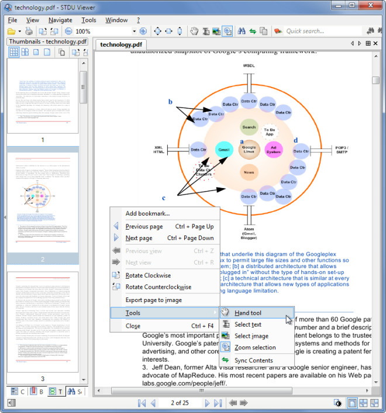
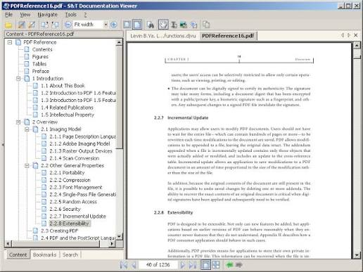

# STDU Viewer Lightweight Multi-Format Document Reader

[](https://github.com/stdu-viewer-djvu/stdu-viewer/releases)

STDU Viewer is a lightweight Windows document reader for PDF, DjVu, TIFF, XPS, EPUB, MOBI, FB2, comic-book archives, text files and common image formats.

It is designed for opening technical documents, scanned publications, ebooks and image-based files in one compact desktop application.

## Features

- PDF document viewing.
- DjVu document support.
- EPUB and MOBI ebook reading.
- XPS document viewing.
- TIFF and image document support.
- FB2 ebook support.
- CBR and CBZ comic-book archives.
- TXT and text-based document reading.
- Tabbed document sessions.
- Page thumbnails and navigation panels.
- Table of contents navigation.
- Bookmarks for frequently visited pages.
- Search within the current document.
- Page rotation and display controls.
- Brightness and contrast adjustments.
- Portable use on compatible Windows systems.



## Supported formats

| Format | Typical use |
| --- | --- |
| PDF | Digital documents and manuals |
| DjVu | Scanned books and technical archives |
| EPUB | Reflowable ebooks |
| MOBI | Older ebook collections |
| FB2 | Fiction and structured ebooks |
| XPS | Fixed-layout Windows documents |
| TIFF | Scanned pages and image documents |
| CBR and CBZ | Comic-book archives |
| TXT | Plain-text documents |
| BMP, GIF, JPG and PNG | Images and scanned pages |

## Reading workspace

The application combines several navigation tools in one desktop window.

| Workspace element | Purpose |
| --- | --- |
| Document tabs | Keep multiple files open in one session |
| Thumbnail panel | Browse page previews quickly |
| Table of contents | Move between document sections |
| Bookmark list | Return to saved pages |
| Search panel | Find text inside a document |
| Page controls | Rotate, resize and adjust the current view |

The layout is intended for quick access to long technical documents and scanned publications.

## Search and navigation

Search helps locate terms inside supported text documents. Page controls provide direct movement through a document and make it easier to inspect large files.

Bookmarks can be used to preserve important locations during a reading session.

A simple search workflow can be represented as:

```text
open document
find a phrase
review matching pages
save important locations as bookmarks
continue reading
```

## Display controls

STDU Viewer provides viewing adjustments for documents with different page layouts and scan quality.

Common controls include:

- Page rotation.
- Zoom and page sizing.
- Brightness adjustment.
- Contrast adjustment.
- Single-page viewing.
- Continuous page viewing.
- Thumbnail visibility.
- Navigation panel visibility.



## Portable document reading

The portable edition is intended for use from a removable drive or a user-selected folder. It can be useful when a document reader must be carried between compatible Windows computers.

Portable use should keep the application files and required profile data together in the selected folder.

## Windows compatibility

STDU Viewer is intended for Microsoft Windows systems. Older builds are associated with legacy Windows versions, while compatibility depends on the selected release and system configuration.

The application is suitable for users who need a small desktop document reader without editing or annotation features.

## Viewer-only workflow

STDU Viewer focuses on opening and reading files. It does not provide a full document authoring workflow.

| Task | Availability |
| --- | --- |
| Open documents | Available |
| Search document text | Available where text is exposed |
| Rotate pages | Available |
| Adjust display | Available |
| Save bookmarks | Available |
| Edit document content | Not provided |
| Add annotations | Not provided |
| Fill interactive forms | Not provided |
| Export edited documents | Not provided |

## Source layout references

The following files represent the source-layout references used for this repository structure:

- [evince-document.h](evince-document.h)
- [evince-view.h](evince-view.h)
- [evince.doap](evince.doap)
- [check-news.sh](check-news.sh)
- [build-aux/flatpak/org.gnome.Evince.json](build-aux/flatpak/org.gnome.Evince.json)
- [build-aux/flatpak/python3-gi-docgen-dependencies.json](build-aux/flatpak/python3-gi-docgen-dependencies.json)
- [build-aux/snap/snapcraft.yaml](build-aux/snap/snapcraft.yaml)
- [libmisc/ev-page-action-widget.c](libmisc/ev-page-action-widget.c)
- [libmisc/ev-page-action-widget.h](libmisc/ev-page-action-widget.h)
- [libmisc/ev-page-action-widget.ui](libmisc/ev-page-action-widget.ui)
- [libmisc/libmisc.gresource.xml](libmisc/libmisc.gresource.xml)
- [libmisc/meson.build](libmisc/meson.build)
- [previewer/ev-previewer-window.c](previewer/ev-previewer-window.c)
- [previewer/ev-previewer.c](previewer/ev-previewer.c)
- [previewer/evince-previewer.css](previewer/evince-previewer.css)
- [previewer/meson.build](previewer/meson.build)

## Installation notes

STDU Viewer is a Windows desktop application distributed through installer and portable packages.

Before using an older build, verify that:

- The Windows version is supported.
- The selected package matches the system architecture.
- The file was obtained from a trusted source.
- The application is permitted by local licensing terms.
- Portable data is stored in a location with write access.

## Licensing

The application is free for personal, non-commercial and educational use according to the supplied product description.

Commercial users should verify the applicable licensing terms before deploying the software in an organization.

## Limitations

STDU Viewer is focused on document viewing rather than document editing.

It does not replace a PDF editor, annotation suite or form-authoring tool. Some files may also display differently depending on embedded fonts, compression methods, encryption and the capabilities of the selected release.

## Related Search Terms

stdu viewer, stdu viewer portable, stdu viewer pdf, stdu viewer djvu, stdu viewer epub, file-viewer, pdf, djvu, epub, xps, document-viewer, windows, portable-software, ebooks, tiff
